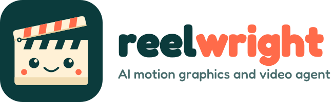

<p align="center">
  <picture>
    <source media="(prefers-color-scheme: dark)" srcset="assets/brand/logo/svg/reelwright-horizontal-for-dark.svg">
    
  </picture>
</p>

<h1 align="center">Reelwright</h1>

<p align="center">An open-source AI agent that works like a motion designer and a video editor.<br>English by default. Kurdish first-class. Right-to-left aware.</p>

<p align="center">
  <a href="#quick-start">Quick start</a> ·
  <a href="#what-it-does">What it does</a> ·
  <a href="skills/reelwright/SKILL.md">Agent skill</a> ·
  <a href="agent/">Agent definition</a> ·
  <a href="#documentation">Docs</a>
</p>

## What it does

Reelwright runs inside a coding agent such as Claude Code or Codex. You talk to the
agent; it plans, designs, renders and checks the video with local tools (Chromium for
frames, FFmpeg for encoding). No video-generation model is involved: every frame comes
from code, your assets and your footage, so every word, color and timing stays editable.

| You give it | It does |
| --- | --- |
| **A script only** | Asks a few briefing questions, proposes three design directions, and builds the one you pick. |
| **A script and a reference** (image, video or link) | Studies the reference's rhythm, easing, composition and look, then recreates that style with *your* logo, colors and fonts from `brand/profile.json`. |
| **Your own footage** (talking head or any video) | Follows your edit instructions exactly. Without instructions it suggests edits; with a style reference it edits in that style. |

Subtle motion is added by default (gentle entrances, punch-ins on key words). Say
"no automatic motion" to turn it off for a project.

### Languages

- **English** is the default. Language is detected from the script; you can always
  name it.
- **Kurdish** (Sorani, Kurmanji, Badini) is first-class: correct right-to-left
  shaping, whole-word animation, Kurdish-specific letters (ڕ ڵ ۆ ێ ە), and an optional
  local word-timing pipeline for Sorani narration.
- **Arabic and Persian** are supported, as is any language your fonts cover.

Kurdish text uses the Kurdish fonts already in `assets/fonts/`. Other languages use
open-license fonts chosen to fit the video's style.

## Quick start

You need Node.js 22 or newer and pnpm 11.

```bash
git clone https://github.com/Eso70/reelwright.git
cd reelwright
pnpm install --frozen-lockfile
pnpm exec playwright install chromium
pnpm reelwright init      # language, brand profile, tool check
```

Then open the folder in your agent:

- **Claude Code:** run `/reelwright`, or just describe the video you want.
- **Codex or other agents:** they read `AGENTS.md`, which points to the skill.

Example requests:

```text
Make a 30-second vertical motion video from script.txt. Ask me what you need.
Recreate the style of reference.mp4 for my script, with my brand colors.
Edit interview.mp4: cut the pauses, reframe to 9:16, add Sorani captions.
```

## Commands

The agent runs these for you; they are listed for scripting and debugging.

| Command | Purpose |
| --- | --- |
| `pnpm reelwright init` | First-run setup |
| `pnpm reelwright doctor` | Check Node, FFmpeg, Chromium, fonts and audio tools |
| `pnpm reelwright create --manifest request.json` | Create a video job (`--resume JOB` to continue) |
| `pnpm reelwright edit --edl edit.json` | Edit footage from an edit decision list |
| `pnpm reelwright fonts recommend --file script.txt` | Fonts that cover a script, ranked by style |
| `pnpm reelwright tools` | Every tool the agent can use, and its status |
| `pnpm reelwright knowledge search "kinetic type"` | Search the motion and editing knowledge base |

All earlier `pnpm video:*`, `audio:*`, `assets:*` and `fonts:*` scripts still work.

## Live status viewer

The mascot shows what the agent is doing (thinking, planning, rendering, done).

```bash
python -m http.server --bind 127.0.0.1
```

Open <http://127.0.0.1:8000/assets/brand/web/state-viewer.html> while a job runs.

## Project layout

```text
agent/       who the agent is: persona, policies, modes, questions, tools, knowledge, evals
skills/      the workflow the agent follows (skills/reelwright/SKILL.md)
src/         engine, renderer, components, animations, presets, motion-library
packages/    editor: footage editing from an edit decision list
audio_pipeline/  optional local Sorani speech alignment (Python)
config/      defaults, locales, fonts, rendering, audio
locales/     what the agent says, per language
brand/       your brand profile (logo, colors, fonts, preferences)
assets/      fonts, brand kit, sound effects, 3D object library, example scenes
references/  reference videos, images and style catalogs
docs/        guides, records, audit and migration notes
examples/    hello-en and hello-ckb smoke examples
scripts/     command-line tools behind the pnpm scripts
tests/       Vitest and pytest suites
```

## Documentation

- [Agent skill](skills/reelwright/SKILL.md): briefing, design, rendering and delivery
- [Agent definition](agent/README.md): persona, modes, questions, tools and knowledge
- [Production system](docs/guides/production-system.md): manifests, commands, recovery
- [Language support](docs/guides/language-support.md): scripts, direction and fonts
- [Voice synchronization](docs/guides/voice-synchronization.md) and [local audio pipeline](docs/guides/local-audio-pipeline.md)
- [Audit](docs/AUDIT.md) and [migration guide](docs/MIGRATION.md)
- [Changelog](CHANGELOG.md)

## Contributing

See [CONTRIBUTING.md](CONTRIBUTING.md). Please read the [Code of Conduct](CODE_OF_CONDUCT.md)
and report security issues as described in [SECURITY.md](SECURITY.md).

## License

The project license has not been chosen yet; see [LICENSE.todo.md](LICENSE.todo.md).
Bundled fonts, sounds and references keep their own terms; see
[THIRD_PARTY_LICENSES.md](THIRD_PARTY_LICENSES.md).
